 

  

<picture>
  <source media="(prefers-color-scheme: dark)" srcset="https://skillicons.dev/icons?i=python,js,react,tailwind,tensorflow,mysql,cpp,c,java,dart,php,git,figma&theme=dark&perline=13" />
  
</picture>

  

<picture>
  <source media="(prefers-color-scheme: dark)" srcset="https://raw.githubusercontent.com/aranya170/aranya170/output/snake-dark.svg" />
  
</picture>

